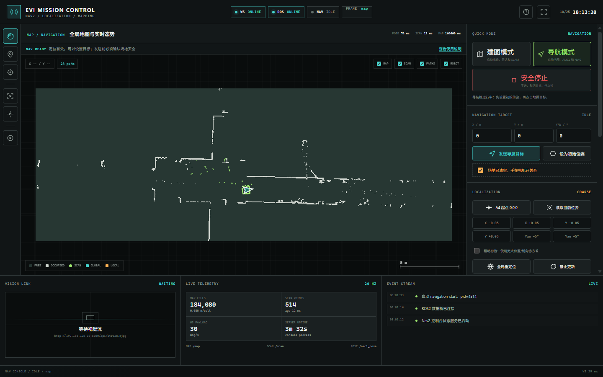
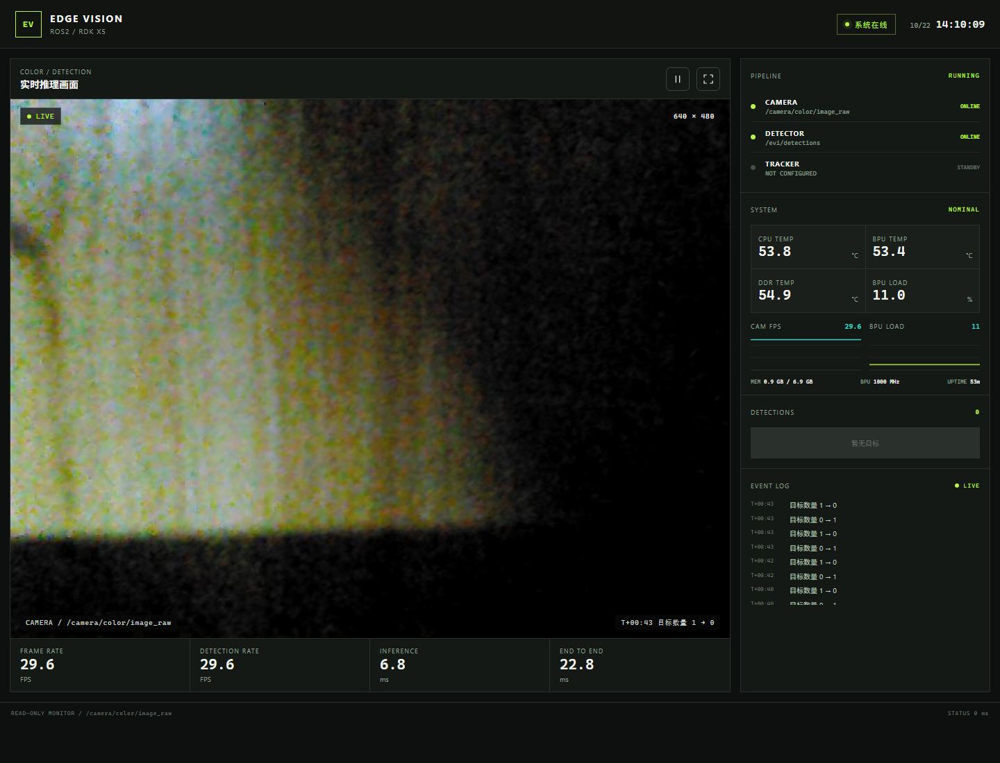
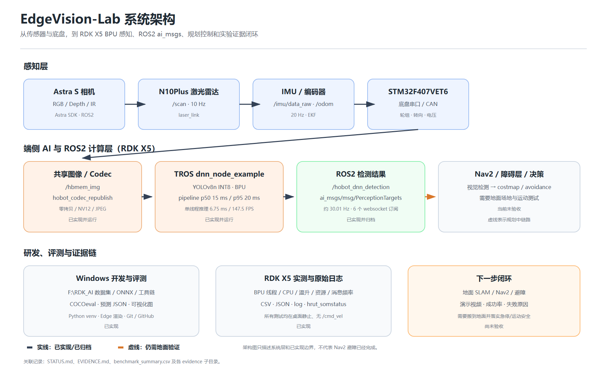

# EdgeVision-Portfolio

刘鸿华的机器人软件、ROS2/Nav2 与端侧视觉工程作品集。

**求职方向：** ROS2 机器人软件实习生（可兼顾系统集成）<br>
**可到岗时间：** 两周内<br>
**邮箱：** 2954812553@qq.com<br>
**简历：** [PDF](resume/RESUME_2026-10-25.pdf) | [Markdown](resume/RESUME_2026-10-25.md)

## 项目概览

| 项目 | 重点 | 可验证结果 |
|---|---|---|
| [ROS2/Nav2 移动机器人](projects/ros2-nav2/) | SLAM、AMCL、Nav2、Ackermann、Web 控制台 | 静态到点 19 s、0 次恢复、横向误差 6.5 cm；单次动态绕障成功；控制台实机 READY |
| [RDK X5 端侧视觉](projects/edge-ai/) | YOLOv8n、INT8 PTQ、BPU、C++ ROS2、QoS 与性能测试 | COCO AP50:95 0.2541，FP32 保留率 91.38%；BPU 约 6.3 ms；双路约 25 FPS |

## ROS2/Nav2 移动机器人

项目使用 Wheeltec 现有 ROS2 驱动与 launch 进行联调，完成 A4 走廊建图、AMCL
定位、Nav2 到点和动态绕障，并开发低延迟可视化控制台。

- `map_a4_20261018`：708×260，0.05 m/格，原点为建图起点。
- AMCL `(0,0,0)`：自建采样评分脚本测得 97.6% 采样点落在 1 格（5 cm）内，平均误差 2.4 cm。
- 静态目标 19 s 完成，0 次恢复，最大横向误差 6.5 cm；同场地开环漂移 36 cm。
- 约 0.3 m 高纸箱单次动态绕障成功，采样范围内最大绕行约 0.45 m、回中线约 8 cm。
- 控制台提供 WebSocket 遥测、地图/雷达/TF/路径显示、建图和 Nav2 操作；
  源码见 [Nav2 Mission Console](projects/ros2-nav2/console/)。



## RDK X5 端侧视觉

在 RDK X5 上完成 YOLOv8n 从 ONNX、OpenExplorer INT8 PTQ 到 BPU 和 C++ ROS2
推理链路的部署，并保留精度、延迟、并发和热数据。

- COCO val2017 全量 5,000 图：FP32/INT8 AP50:95 `0.2780/0.2541`，保留率 `91.38%`。
- BPU 单帧推理均值约 `6.3 ms`，ROS2 检测结果发布约 `30 Hz`。
- 双路视频在 `depth=5 + reliable` 下连续 10 分钟保持约 `25 FPS`。
- 30 分钟风扇工况 soak、10 分钟 BPU/CPU 合成深度异构并发与 QoS 回归。
- 真实 Astra S：2 分钟检测均值 `29.602 FPS`，单帧 p95 `24.364 ms`，40 ms 超时 `0`。



## 系统架构



## 仓库结构

```text
resume/                     最终简历
projects/ros2-nav2/         Nav2 控制台、launch、配置与 A4 证据
projects/edge-ai/           C++ ROS2 推理节点、测试工具、文档与 benchmark
docs/architecture/          系统架构图
docs/RESULTS.md             结果汇总与证据边界
```

## 复现说明

- ROS2 控制台依赖 `aiohttp`、ROS2 Humble/TROS 与 Wheeltec 底盘驱动。运行方法见
  [项目说明](projects/ros2-nav2/README.md)。
- 端侧视觉节点依赖 RDK X5 BPU、OpenExplorer 运行库和 TROS；构建方式见
  [项目说明](projects/edge-ai/README.md)。
- 硬件相关结果不能直接外推到其他底盘、雷达、相机或场景。

## 结果边界

- 动态绕障为单次受控实验，不等同于多场景稳定性或功能安全。
- 30 分钟 soak 为风扇开启工况。
- 无目标 Astra S 画面只验证吞吐、延迟和稳定性，不用于召回率或 MOT 指标。
- 故障恢复由测试工具触发，不宣称为生产级 watchdog。

完整数据和适用边界见 [结果汇总](docs/RESULTS.md)。
