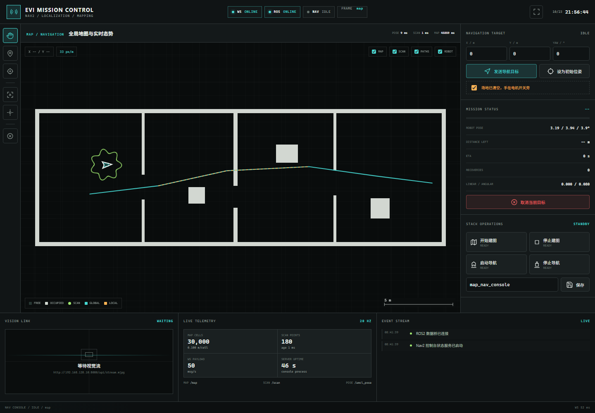
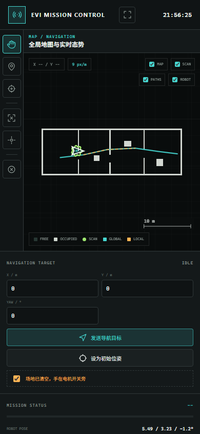
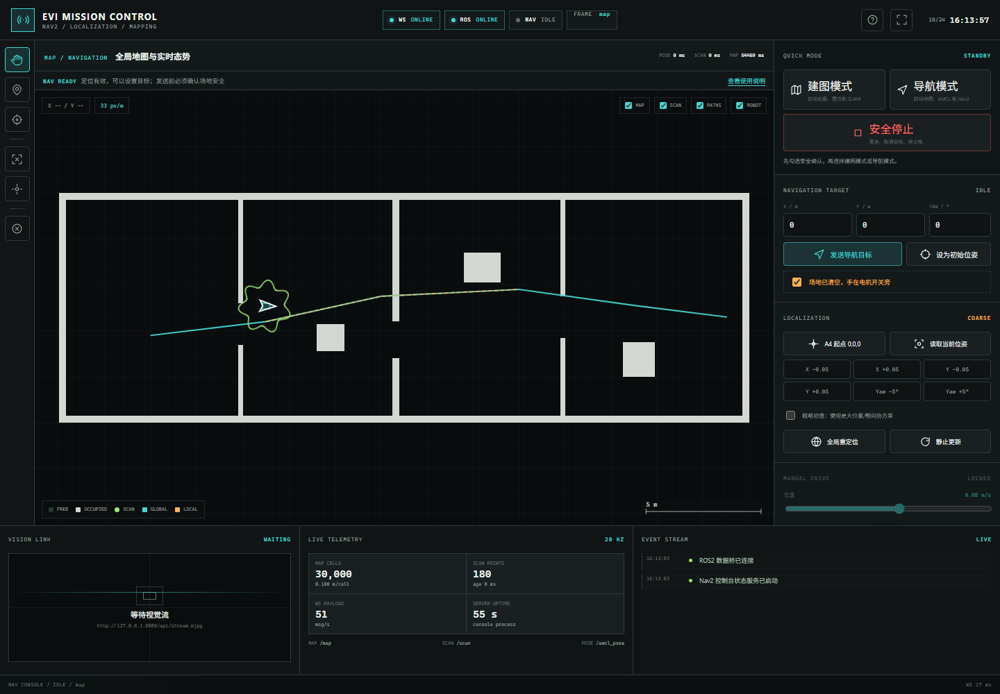
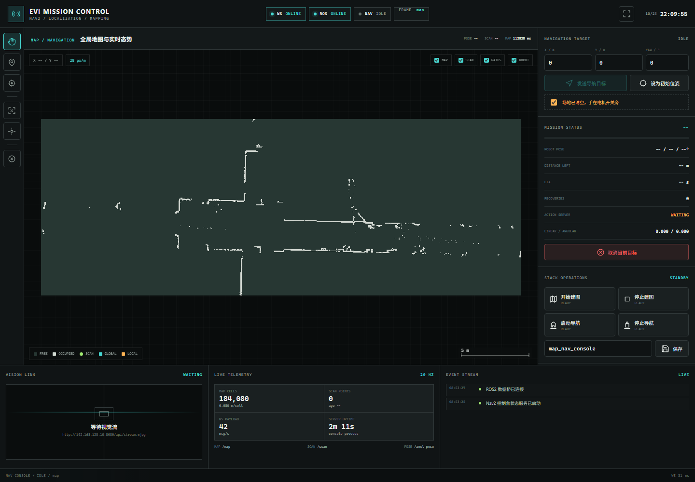
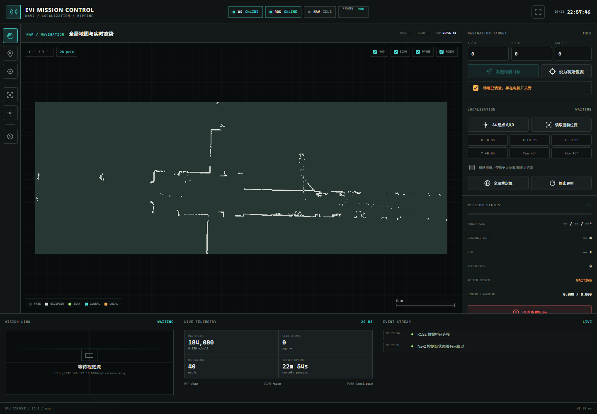
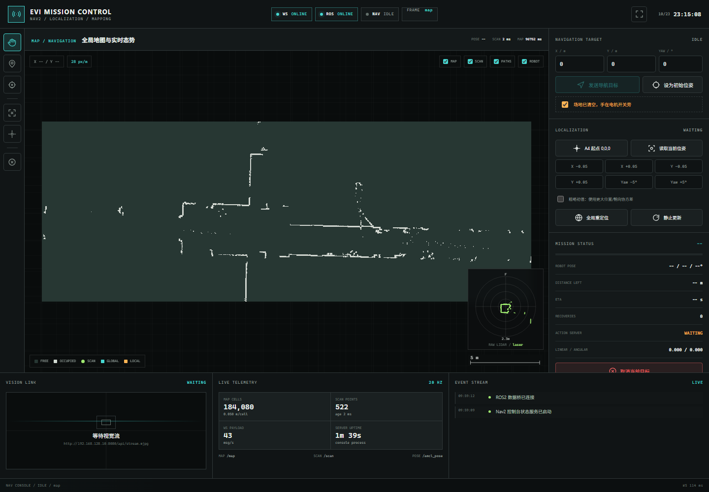

# EVI Nav2 Mission Console

单独运行的 Nav2 建图、定位、导航和状态可视化上位机，不替代原有视觉监控页。

```text
浏览器
  |
  |  WebSocket: telemetry / scene / status / binary map
  |  HTTP POST: 受限命令
  v
nav_console/server.py
  |
  +-- rclpy: /map /scan /tf /plan /local_plan /odom_combined
  +-- NavigateToPose action
  +-- /initialpose
  +-- 白名单建图/导航进程
```

## 先做的开源调研

| 项目 | 可借鉴点 | 不直接采用的原因 |
|---|---|---|
| [rosboard](https://github.com/dheera/rosboard) | 自定义轻量 WebSocket；不把完整 ROS 超级权限暴露给浏览器；对大地图/图像做压缩 | 通用话题查看器，不是 Nav2 任务操作台 |
| [rosbridge_suite](https://github.com/RobotWebTools/rosbridge_suite) | ROS2 WebSocket 生态成熟；topic/service/action 覆盖完整 | 浏览器直接获得广泛 ROS 操作面；大地图 JSON 传输和权限边界不适合专用控制台 |
| [Webviz](https://github.com/cruise-automation/webviz) | Canvas/WebGL 图层、布局和 rosbag 可视化 | 偏调试和回放，不包含项目自己的建图/导航流程 |
| [Foxglove Studio](https://github.com/foxglove/studio) | 完整机器人调试体验 | 原仓库已归档，定制任务操作和部署成本高 |
| [Rerun](https://github.com/rerun-io/rerun) | 高性能多模态时间序列 | 更适合数据回放与分析，不是 ROS2 实机任务控制台 |

本实现采用 Rosboard 的核心思路：专用 WebSocket 协议、受限命令面、服务端压缩/编码大数据。

## 已验收

2026-10-23 mock 与浏览器验收：

- WebSocket telemetry 实测 `20.33 Hz`，平均间隔 `50.05 ms`。
- 桌面 `1440x1000`：无横向或纵向溢出，Canvas 检测到 `79,989` 个非透明像素。
- 手机 `390x844`：无横向溢出，Canvas 检测到 `11,291` 个非透明像素。
- 两种视口下 WebSocket/ROS 均为 ONLINE，安全确认可启用目标按钮，浏览器异常与控制台 error 均为 0。
- 未做安全确认的导航目标返回 HTTP `409`。
- 跨站 Origin 返回 `403`，非 JSON Content-Type 返回 `415`。
- 真实 ROS 桥在未启动 Nav2/底盘时成功初始化 `rclpy`、TF 和 NavigateToPose action client。





新版快速模式、导航控制和建图遥控入口：



Mock 验收已覆盖：

- 建图模式启动；
- 安全确认后接受低速遥控；
- 安全停止发送零速并退出建图模式；
- 建图模式切换导航模式时自动停止另一套栈。

真实 A4 地图通过 `nav2_map_server` 本地预览：



这张图只启动了 `map_server`，没有启动 Nav2 控制器、AMCL 或底盘，因此
ROBOT POSE 显示 `--`，ACTION SERVER 显示 `WAITING`，导航目标按钮保持禁用。

新增定位工具后的真实地图页面：



只启动雷达、尚未建立 map TF 时，页面会显示 LASER FRAME 原始极坐标扫描，
不会把未定位点伪造成地图坐标：



2026-10-23 实测：

- `/scan` publisher：`1`；
- N10Plus 扫描频率约 `9.997–10.005 Hz`；
- 原始点约 `522`，frame `laser`；
- `scan_transformed=false` 时显示 RAW LIDAR 面板；
- 底盘和 AMCL 恢复、`map -> laser` TF 可用后，同一批点会自动切换到地图叠加。

## 低延迟设计

- 不使用 350 ms HTTP 轮询。
- 单 WebSocket 默认推送 telemetry `20 Hz`，scene `10 Hz`。
- `/map` 使用二进制消息，只在 revision 变化时推送，最多 `2 Hz`。
- 激光点、路径和位姿都使用一帧内批量 JSON，避免每点单独发消息。
- 浏览器 Canvas 直接绘制 occupancy grid、scan、path、footprint 和 pose。
- 视频继续使用现有 MJPEG 流，避免在新进程重复编码相机。

## 功能

- OccupancyGrid 地图、平移、缩放、自动适配、跟随机器人。
- `/scan`、`/plan`、`/local_plan`、footprint、map->base TF。
- 建图/导航两种快速模式，切换时自动停止另一套栈。
- 建图模式下的网页低速方向控制，0.03–0.12 m/s，支持前进、左转前进、右转前进和立即停车。
- 遥控 deadman：浏览器停止发送 0.35 秒后，板端自动发布 `/cmd_vel = 0`。
- Nav2 `NavigateToPose` 目标、反馈、结果、取消。
- `/initialpose` 初始位姿。
- 建图启动/停止、Nav2 启动/停止、地图保存。
- 安全确认：发送运动目标前必须勾选“场地已清空，手在电机开关旁”并二次确认。
- 所有操作来自 JSON 白名单，不接受任意 shell 字符串。

## 板端启动

先确保原视觉监控页可选择启动在 `8080`，然后：

```bash
cd /home/wheeltec/evi/evi_dashboard
cp nav_console/config.example.json nav_console/config.json
bash board_agent/start_nav_console.sh
```

打开：

```text
http://192.168.128.10:8091
```

停止：

```bash
bash /home/wheeltec/evi/evi_dashboard/board_agent/stop_nav_console.sh
```

## Mock 模式

不启动 ROS 也能检查界面：

```bash
python3 nav_console/server.py \
  --mock \
  --host 127.0.0.1 \
  --port 8091 \
  --web-root nav_console/web
```

Mock 模式不会执行 `config.json` 中的真实进程命令。

从 mock 切换到真实 ROS：

```bash
bash /home/wheeltec/evi/evi_dashboard/board_agent/stop_nav_console.sh
bash /home/wheeltec/evi/evi_dashboard/board_agent/start_nav_console.sh
```

正式启动脚本会检测 8091 是否仍被 mock 占用，并拒绝误启动。
真实模式在没有 `/map` 或 Nav2 action server 时会显示 OFFLINE/ACTION_UNAVAILABLE，不会伪造数据。

## 浏览器冒烟测试

可用 Edge/Chromium 的 CDP 无头模式检查 WebSocket、地图 Canvas 和安全按钮：

```powershell
$edge = "C:\Program Files (x86)\Microsoft\Edge\Application\msedge.exe"
Start-Process $edge -ArgumentList @(
  "--headless=new",
  "--no-sandbox",
  "--remote-debugging-port=9223",
  "--user-data-dir=$env:TEMP\evi-nav-console-smoke",
  "http://192.168.128.10:8091"
)
node nav_console/tools/browser_smoke.mjs http://192.168.128.10:8091 9223
```

## 配置

编辑 `nav_console/config.json`：

- `topics.*`：地图、扫描、路径、里程计话题；
- `actions.navigate_to_pose`：Nav2 action 名；
- `operations.*`：只允许这里声明的命令；
- `camera_stream_url`：现有视觉监控页的 MJPEG 地址；
- `ws_hz` / `scene_hz` / `map_hz`：推送频率。

`navigation_start` 默认使用 A4 地图和参数：

```text
map_a4_20261018.yaml
param_mini_akm_a3.yaml
```

如果板端路径或配置变化，必须同步修改 `config.json`。

## 初始位姿使用方法

推荐顺序：

1. 如果车停在 A4 建图起点且车头方向一致，点击“A4 起点 0,0,0”。
2. 点击“设为初始位姿”。
3. 观察 ROBOT POSE、SCAN 和 LOCALIZATION 是否变为 GOOD。

如果只是粗略知道位置：

1. 在地图上点击大致位置。
2. 勾选“粗略初值”，发送更大协方差。
3. 让车沿有区分度的墙面缓慢移动一小段，等待 AMCL 收敛。
4. 收敛后点击“读取当前位姿”，再作为下一次基准。

如果完全不知道位置：

1. 确认当前场地与加载地图一致。
2. 点击“全局重定位”。
3. 通过安全驾驶让车经过门框、墙角或不对称障碍。
4. 不要一开始就在长直对称走廊里依赖全局重定位，容易出现镜像或纵向歧义。

“静止更新”只请求 AMCL 在当前粒子上做一次无运动更新，不负责凭空搜索整个地图。

最稳定的工程方案仍是固定停车位：

- 在地面标出车体中心 `x=0, y=0`；
- 用墙或车体夹具固定车头朝向；
- 让物理起点与建图起点一致。

## 最短使用流程

### 建图

1. 打开页面，勾选“场地已清空，手在电机开关旁”。
2. 点击“建图模式”。
3. 等待雷达、地图和机器人位姿出现。
4. 在“MANUAL DRIVE”中按住前进/左转/右转，低速移动机器人。
5. 松开按键立即发送零速；离开页面也会自动零速。
6. 建图完成后填写地图名并保存，再点击“安全停止”。

### 导航

1. 点击“导航模式”，上位机会停止建图栈并启动唯一一套 Nav2。
2. 等待 `ACTION SERVER READY`。
3. 点击“A4 起点 0,0,0”或在地图上选择实际初始位姿。
4. 点击“设为初始位姿”，等待 LOCALIZATION 为 GOOD。
5. 用地图图钉选择目标，勾选安全确认，再点击“发送导航目标”。
6. 点击“安全停止”可取消目标、发送零速并停止当前栈。

## 安全边界

- 不提供任意 shell 执行。
- 命令接口只接受同源 `application/json` 请求，拒绝跨站命令。
- 不提供手持遥控或直接速度控制。
- 发送导航目标要求明确安全确认。
- 停止导航时先取消 action、发送零速，再停止 launch 进程。
- 建图/导航启动不会自动发送运动目标。
- 当前实现尚未在真实 Nav2 栈上执行地面导航验收；真实运动仍须用户确认场地安全。
- 控制台没有用户登录系统，只应运行在受控机器人局域网，不应直接暴露到公网。

## 当前验收状态

- 本地 mock：快速建图/导航模式、互斥切换、低速遥控、安全停止均已通过。
- 真实 A4 地图和 N10Plus 原始扫描此前已通过浏览器验收。
- 免 sudo 底盘 launch 已确认能让 `wheeltec_robot_node` 使用 `/dev/ttyACM0` 启动。
- RDK 关机前的最后一轮 `spin_once` 回调和快速模式版本尚未在重启后的真实栈上复验。
- 下次开机后必须先做静止联调，确认 `/map`、`/scan`、`map -> base_footprint` 和 `ACTION SERVER READY` 同时出现，再允许地面测试。

已验证项、未验证项、已知限制和不可宣称项的完整清单见
[LIMITATIONS.md](LIMITATIONS.md)。

## 2026-10-25 实机校正（以此节为准）

### 运行架构

```text
浏览器
  | WebSocket telemetry / scene / status + binary map
  v
nav_console/server.py
  | Unix Socket: /tmp/evi_nav_bridge.sock
  v
nav_console/tools/bridge_socket_proxy.py
  | stdin/stdout JSON lines
  v
nav_console/ros_bridge_process.py
  | rclpy: /map /scan /tf /odom /plan /local_plan
  + NavigateToPose action + /initialpose + /cmd_vel
```

RDK 的 TROS/FastDDS 存在首参与者异常：第一个桥能看到 publisher，但收不到样本；
第二个参与者正常。因此启动脚本会先保留一个无订阅的 `evi_nav_dds_warmup` 节点，
再启动正式桥。该现象已在同一建图栈、同一桥代码下通过 A/B 对照复现。

另外，`mapping_start` / `navigation_start` 在桥或预热节点仍存活时不得删除
`/dev/shm/fastrtps_*`，否则会直接破坏正在运行的数据面。启动脚本已加入保护。

### 静止验收结果

2026-10-25 开机后 `/dev/shm` 为 0，随后完成以下实机静止验收：

- 从控制台 API 启动唯一建图栈，地图更新到 `118×67`，雷达约 498 点；
- `laser -> map` 变换成功，线速度 `0.0`，角速度接近 `0.0`；
- 地图保存实测生成 `.pgm` 与 `.yaml`，保存进程 `code=0`；
- 切换到唯一 Nav2 栈后 `/map` 为 `708×260`，雷达约 509 点；
- `controller_server`、`planner_server`、`smoother_server`、`behavior_server`、
  `waypoint_follower`、`bt_navigator` 均为 `active [3]`；
- 控制台 `ACTION SERVER READY`，`goal_active=false`，未发送导航目标；
- 浏览器实测 `WS ONLINE`、`ROS ONLINE`、地图 Canvas 正常、雷达点可见；
- 桌面 `1440×900` 页面无横向溢出，前端异常和 console error 均为 0。

证据截图位于：

```text
nav_console/docs/desktop-real-nav-ready.png
nav_console/docs/desktop-real-live.png
nav_console/docs/mobile-real-live.png
```

### 启停与诊断

```bash
bash /home/wheeltec/evi/evi_dashboard/board_agent/start_nav_console.sh
bash /home/wheeltec/evi/evi_dashboard/board_agent/stop_nav_console.sh
```

启动脚本同时管理：

- `/tmp/evi_nav_warmup.pid`
- `/tmp/evi_nav_bridge.pid`
- `/tmp/evi_nav_console.pid`

只读冒烟测试：

```bash
/home/wheeltec/evi/evi_dashboard/nav_console/tools/run_bridge_smoke.sh 8
```

### 尚未完成

- 本轮没有发送真实导航目标，也没有让底车移动；
- 地面导航、动态绕障和故障恢复仍需在用户明确确认“场地清空、手在电机开关旁”后执行；
- A3 语义标记与下视相机贴线仍未进入本控制台。

